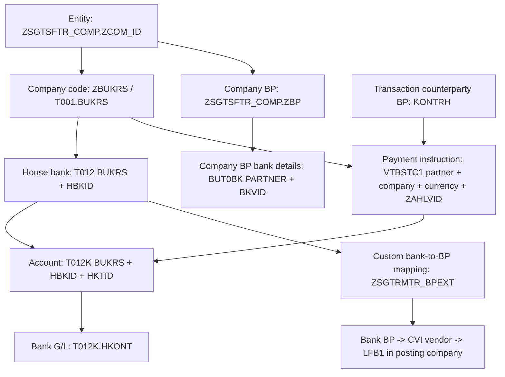

# House-bank, partner and company-code configuration for settlement

Derived from the original `ZSGTSF_RDEAL_TRD_INV` and `ZSGTSF_RDEAL_TRD_POST` exports and the current application. This describes the configuration relationships required by these programs. It does not assert that particular master-data rows currently exist in SAP.

## Manual selection in the application (16 October 2026)

Until the standing-instruction mapping is exposed, MO Execute Settlement allows users to select the house bank and account directly:

1. Open an FX transaction's settlement popup. Receiving/paying companies come from the saved transaction or SET_FX; an empty company defaults to the transaction company.
2. Choose each side's company, house bank and account. The existing `housebank/HouseBankAccount` OData supplies company-specific accounts, currencies, descriptions and bank G/L. The G/L is displayed for the selected account.
3. Payment ID options use that company's `ZSGTSFTR_COMP.ZBP` through `slctsfbpbank/SlcTsfBpBank`, filtered by BP and company. If that lookup fails or the company BP is missing, the Payment ID remains manually editable. Receiving/Paying Bank ID remain separately editable payment-instruction IDs; selecting a house bank does not invent an instruction or a BP bank-detail mapping.
4. Update or Settlement Complete uses the existing TrmFxApp PATCH path to save buy/sell bank, account, company and payment IDs. Explicit cleared values are now included so a previous account is actually removed. DSS mirroring follows the existing settlement logic.

Changing company clears that side's bank, account and company BP bank-detail ID. Changing house bank clears its account. Saving rejects incomplete or unavailable bank/account pairs; SET_FX account category `01` requires a bank/account pair. Existing saved values remain visible while loading or when absent from the returned choices.

This manual fallback scopes sell-side accounts to the selected **Pay Co Code**. The original VTBSTC1 sell lookup instead uses transaction company, as documented below. Automatic standing-instruction derivation is still a separate gap.

Trade invoice payment popups use the same bank/account selectors, scoped through each sender/receiver entity's company. Their existing receipt/posting locks remain in place. Update saves `ZHBKID` / `ZHKTID` and `ZREC_HBKID` / `ZREC_HKTID` through the existing TRD_POS path; BO account determination already reads these fields and resolves the bank G/L.

Browser verification uses intercepted API responses and captured writes. It does not prove that updating TrmFxApp propagates to VTBFHA or changes the banking used by SAP's FX posting. That backend propagation must still be verified before treating this as an end-to-end SAP FX posting integration.

## Configuration relationships

The bank mapping arrow represents the program's custom lookup; `ZSGTRMTR_BPEXT` uses different house-bank columns for some companies. It is not a standard foreign key from T012 to a globally unique BP.

## What must be configured

| Configuration | Tables and fields | Required relationship |
| --- | --- | --- |
| Company/entity identity | `T001`: `BUKRS`; `ZSGTSFTR_COMP`: `ZCOM_ID`, `ZBUKRS`, `ZBP`, `ZVENDOR`, `ZCUSTOMER` | Each seller/buyer entity resolves to its company code and company BP. Vendor/customer values are required for posting categories that use them. |
| Company posting dimensions | `ZSGTSFTR_COMP`: `ZPRCTR_B`, `ZRBUSA_B`, `ZRBUSA`; MC `ZORIGIN` | Bank/clearing lines derive profit center and business area from the posting company configuration. For AE13, the original takes business area from the origin entity's `ZRBUSA` when found. |
| Bank master | `BNKA`: `BANKS`, `BANKL`, `BANKA`, `SWIFT`, `BRNCH` | T012 and partner-bank records refer to the appropriate bank country/key. Names and SWIFT support bank details and letters. |
| House bank per company | `T012`: `BUKRS`, `HBKID`, `BANKS`, `BANKL` | The company owns the house-bank assignment. Reusing an HBKID in two companies does not identify the same account. |
| Account under that house bank | `T012K`: `BUKRS`, `HBKID`, `HKTID`, `BANKN`, `WAERS`, `HKONT` | The complete company/house-bank/account combination must resolve to the intended bank account, currency and bank G/L. |
| Company BP bank details | `ZSGTSFTR_COMP.ZBP` -> `BUT0BK.PARTNER`; `BUT0BK`: `BKVID`, `BANKS`, `BANKL`, `BANKN` | Each receiving/paying company's selected BP bank ID must belong to that company's BP and identify its intended bank account. |
| Treasury payment instruction | `VTBSTC1`: `PARTNR`, `BUKRS`, `WAERS`, `ZAHLVID`, `BVTYP`, `HBKID`, `HKTID` | For a transaction counterparty, company, currency and instruction ID, resolve the correct house bank/account. The program's lookups must yield an unambiguous result. |
| Bank BP mapping | `ZSGTRMTR_BPEXT`: `BP`, `HBKID` and applicable company-specific house-bank columns | Map the selected house bank to the bank business partner when bank-BP accounting or letters require it. See company-specific rules below. |
| Bank BP's vendor in posting company | `BUT000`: `PARTNER`, `PARTNER_GUID` -> `CVI_VEND_LINK`: `PARTNER_GUID`, `VENDOR` -> `LFB1`: `LIFNR`, `BUKRS`, `AKONT` | The bank BP must resolve to a vendor with a company-code segment and reconciliation account in the company receiving the FI posting. |
| Trading entity's supplier/customer in posting company | `ZSGTSFTR_COMP.ZVENDOR` -> `LFB1(LIFNR,BUKRS).AKONT`; `ZCUSTOMER` -> `KNB1(KUNNR,BUKRS).AKONT` | Company-specific vendor/customer accounting must exist wherever the leg is posted. A BP or vendor number alone does not establish the company-code segment used by these reads. |
| Model/leg routing | `ZSGTSFTR_SET_FX`: `ZMOD_ID`, `ZD_MAP`, `ZBS`, `ZCURR`, `ZACC`, `ZRBUKRS`, `ZPAY_ID`, `ZBANK_ID`, `ZTRF_TYPE`; `ZSGTSFTR_SET_TYP`: `ZMOD_ID`, `ZT_TYPE`, `ZBUKRS`, `ZSELL`, `ZBUY`, `ZSET_CURR`, `ZFI_TYPE` | Choose the company, partner-bank/payment instruction, bank category and posting type appropriate to each model and side. |
| Posting category | `ZSGTSFTR_TRD_ACC`: `ZFI_TYPE`, `ZDEBIT`, `ZCREDIT`, `ZDR_ACC`, `ZCR_ACC`, `ZDR_ENT`, `ZCR_ENT`, `ZDOC_TYPE` | Determines whether each FI line uses a house-bank G/L, entity vendor/customer, clearing G/L or bank BP. Only the configuration required by the chosen categories is relevant to that line. |

## Three BP roles and two bank-ID types

1. **Company BP:** `ZSGTSFTR_COMP.ZBP`. The original bank-ID helps join this BP to BUT0BK using the receiving/paying company code. These selected bank IDs are stored in `ZTSF_RPAYID` / `ZTSF_PPAYID`.
2. **Transaction counterparty BP:** `KONTRH`. The original payment-instruction lookup uses it as `VTBSTC1.PARTNR`; the selected instruction is stored in `ZTSF_BPAYID` / `ZTSF_SPAYID`.
3. **Bank BP for accounting:** `ZSGTRMTR_BPEXT.BP`, resolved from the selected house-bank mapping. BO bank-BP posting resolves this BP to a vendor and LFB1 reconciliation account.

**`ZAHLVID` (payment instruction) and `BKVID` (BP bank-detail ID) are separate identifiers.** Current popup labels can obscure this: app `bBankId` / `sBankId` carry BPAYID / SPAYID, while `bPaymentId` / `sPaymentId` carry RPAYID / PPAYID. Use the backend fields when specifying configuration.

## Which company is used in each lookup

| Flow | Original lookup |
| --- | --- |
| FX buy-side house-bank derivation | `VTBSTC1`: counterparty `KONTRH` + receiving company `ZTSF_RBUKRS` + buy currency + instruction `ZTSF_BPAYID` -> `ZTSF_BHBKID`, `ZTSF_BHKTID` |
| FX sell-side house-bank derivation | `VTBSTC1`: counterparty `KONTRH` + **transaction company `BUKRS`** + sell currency + instruction `ZTSF_SPAYID` -> `ZTSF_SHBKID`, `ZTSF_SHKTID` |
| Receiving company BP bank details | `ZSGTSFTR_COMP.ZBUKRS = ZTSF_RBUKRS` -> `ZBP` -> `BUT0BK.BKVID = ZTSF_RPAYID` |
| Paying company BP bank details | `ZSGTSFTR_COMP.ZBUKRS = ZTSF_PBUKRS` -> `ZBP` -> `BUT0BK.BKVID = ZTSF_PPAYID` |
| Trade invoice default bank | `VTBSTC1`: company BP `ZSGTSFTR_COMP.ZBP` + leg company `SET_TYP.ZBUKRS` + settlement currency + `ZAHLVID = 'TRDINV'` -> house bank/account |
| Trade invoice sender/payer bank | Buyer entity `ZBUY` -> company; selected bank stored in `TRD_POS.ZHBKID`, `ZHKTID` |
| Trade invoice receiver/payee bank | Seller entity `ZSELL` -> company; selected bank stored in `TRD_POS.ZREC_HBKID`, `ZREC_HKTID` |
| Vendor/customer reconciliation | Always resolve the vendor/customer segment in the **FI posting company's** `BUKRS`. |

Original buy payment-ID value help filters `gs_vtbfha-bukrs`, whereas its later `PROCESS` lookup filters `ZTSF_RBUKRS`. The sell `PROCESS` lookup uses transaction company even when a separate paying company is shown. These are source differences to reconcile explicitly when implementing the app; a global company-code filter would lose them.

## Company-specific house-bank columns

MO `receipt_housebank` uses these columns when locating the bank BP for applicable letters:

| Company code | Field on ZSGTRMTR_BPEXT |
| --- | --- |
| `AE13` | `ZHBKID_DMCC` |
| `SG03` | `ZHBKID_OGA` |
| `IN10` | `ZHBKID_OAIPL` |
| `IN11` | `ZHBKID_OSIPL` |
| Other companies | `HBKID` |

BO trade-invoice bank-BP accounting has a narrower rule: **SG03 uses `ZHBKID_OGA`; other companies use `HBKID`**, along with the vendor extension in the posting company. Do not automatically apply MO's letter mapping to BO posting. `ZHBKID_OAIPL` / `ZHBKID_OSIPL` occur inside dynamic SQL strings and were omitted by the export's static field CSV; verify their active DDIC/resource exposure.

## Accounting categories

| Flow/configuration field | Code | Required configuration |
| --- | --- | --- |
| Trade invoice `TRD_ACC.ZDR_ACC` / `ZCR_ACC` | `01` | House-bank/account G/L from T012K |
| Same | `02` | Trading entity vendor and LFB1 reconciliation account |
| Same | `03` | Trading entity customer and KNB1 reconciliation account |
| Same | `04` | Clearing G/L from TRACC_ACCSYMBREP by chart `OL10`, `AA_REF = 'FXEXT10'`, settlement currency |
| Same | `05` | House-bank -> bank BP -> vendor -> LFB1 in posting company |
| FX `SET_FX.ZACC` | `01` | House-bank/account G/L |
| FX `SET_FX.ZACC` | `02` | Original preview uses transaction counterparty BP -> vendor -> LFB1 in transaction company |
| FX `SET_FX.ZACC` | `04` | Currency-specific external-bank clearing G/L |

The two configuration fields use different code sets. For example, FX bank-BP category `02` must not be interpreted as trade-invoice bank-BP category `05` without knowing the source field. FX preview also reads the internal clearing mapping `AA_REF = 'FXTSF'`, `ACC_SYMBOL = '8.5'` in chart `OL10` and flow-specific posting dimensions from ZSGTRMTR_FLOWS.

## Configuration collection sheet

For each required settlement route, obtain:

`Model + leg/side + transaction company + FI posting company + receiving/paying company + currency + counterparty BP + company BP + payment instruction ZAHLVID + company BP bank ID BKVID + house bank HBKID + account HKTID + bank G/L + bank BP/vendor/reconciliation G/L where applicable`.

Use the actual values agreed for that company/model. The account tuple is `BUKRS + HBKID + HKTID`; BP bank details use `PARTNER + BKVID`; payment instructions use the filters specified above. Matching bank account/currency and company/vendor segments should be checked before wiring these rows into the app.

## Evidence and current app gaps

Existing OData reuse, verified by metadata GETs returning 200 on 16 October 2026 at 17:28 IST: `housebank/HouseBankAccount` covers the company/house-bank/account master; `slctsfbpbank/SlcTsfBpBank` covers BP bank details; `businesspartner` includes supplier/customer company data. These cover their respective parts of settlement. The checked services do not expose the VTBSTC1 standing-instruction mapping keyed by partner + company + currency + ZAHLVID. That mapping could be added to an existing OData service; it does not inherently require a separate service group.

- Original MO `INCLUDE__ZSGTSF_RDEAL_TRD_INV_TXN_POST.abap:2110` onward: payment-ID help, account derivation and company-BP bank-ID helps.
- Original BO `INCLUDE__ZSGTSF_RDEAL_TRD_POST_PBO.abap:659` onward: invoice company/VTBSTC1/T012K joins.
- Original BO `INCLUDE__ZSGTSF_RDEAL_TRD_POST_POST.abap:108` onward: bank BP/vendor/company join; `:219` onward: receiver/payer bank G/L; `:340` onward: SG03 bank-BP mapping.
- Original MO `INCLUDE__ZSGTSF_RDEAL_TRD_INV_POST.abap:3060`: company-specific letter mapping.
- Original BO `INCLUDE__ZSGTSF_RDEAL_TRD_POST_TXN_P.abap:249` onward: FX flow, counterparty-vendor and account-category logic.
- App `apps/web/src/features/bo-post-accounting-settlement/determination.ts` implements several posting lookups. App `apps/web/src/shared/fx/house-bank.ts` reads house-bank accounts by company. VTBSTC1 account derivation, complete company-BP bank-ID selection and the clearing lookup remain incomplete in these settlement flows. Master-data configuration and those integration gaps both need to be addressed.

Original source roots are recorded in [the audit](Settlement-OData-Gap-Audit-2026-10-16.md). No SAP master data or application behavior was changed for this configuration review.
